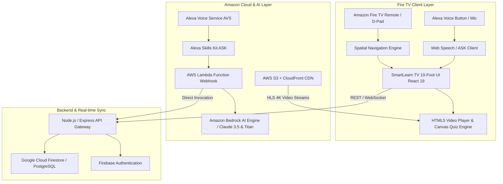

# SmartLearn TV - System Architecture & Engineering Blueprint

SmartLearn TV is an AI-powered 10-foot television educational platform engineered specifically for **Amazon Fire TV**, integrating voice-first conversational intelligence via **Amazon Alexa**, multi-modal generative explanations through **Amazon Bedrock**, and interactive television UI/UX.

---

## 1. High-Level Architecture Diagram

---

## 2. Technical Stack Breakdown

| Layer | Technology | Purpose |
|---|---|---|
| **TV Frontend** | React 19, TypeScript, Tailwind CSS v4 | 10-foot Television UI, 60fps animations |
| **TV Navigation** | Custom Spatial D-Pad Hook (`useTVNavigation`) | Handles ArrowUp/Down/Left/Right, Enter, Back, Media controls |
| **Voice Interface** | Amazon Alexa Skills Kit + Web Speech API | Hands-free learning, voice search, quiz control |
| **AI Doubt Solver** | Amazon Bedrock (Claude 3.5 Sonnet / AWS Titan) | Step-by-step doubt resolution, formulas, whiteboard derivations |
| **Backend API** | Node.js, Express.js | Device code activation, RESTful endpoints, parent guard |
| **Database** | Google Cloud Firestore & Relational PostgreSQL | User profiles, quiz attempts, doubts audit logs, tasks |
| **Video Streaming** | AWS S3 + AWS CloudFront (HLS / MPEG-DASH) | 4K / 1080p adaptive bitrate educational video playback |
| **Device Auth** | Firebase Authentication + 6-digit TV Device Pairing | Zero-friction mobile QR code pairing to television |

---

## 3. Remote-Friendly 10-Foot UI Design Principles

1. **Focus State Prominence**:
   - Every interactive element has an active scale factor (`1.05x`) with an Amazon Fire TV cyan outline (`#00a8e1`) and glow box-shadow.
2. **Spatial D-Pad Traversals**:
   - Navigation calculates Euclidean distances between focusable bounding boxes so users never get lost with horizontal and vertical directional inputs.
3. **Typography & Readability**:
   - Large fonts (minimum 14px up to 48px headings), high-contrast text ratios exceeding WCAG AAA standards on high-definition and 4K displays.
4. **Zero Mouse Dependency**:
   - All flows—from user authentication via QR/PIN code to answering MCQs and opening AI doubts—are 100% controllable via the Fire TV 5-way directional pad.

---

## 4. Multi-Language & Rural Inclusivity Engine

SmartLearn TV is designed to bridge the educational divide across urban and rural environments:
- **Offline Mode**: Videos and quizzes can be saved to internal Fire TV storage (cache management provided in Settings).
- **Multi-Lingual Voice & Content**: Immediate one-click switching between **English**, **Hindi (हिन्दी)**, and **Punjabi (ਪੰਜਾਬੀ)** with phonetically aligned text-to-speech.
- **Adaptive Bitrate**: Automatically steps down stream resolution to 720p/480p on unstable or constrained rural broadband connections.
