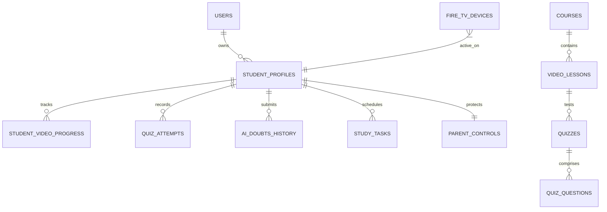

# SmartLearn TV - Database Schema Specification

This document details both the **Relational (PostgreSQL)** and **NoSQL (Google Cloud Firestore)** schemas powering SmartLearn TV.

---

## 1. Entity-Relationship Diagram (ERD)



---

## 2. Firestore Document Collections

### `users/{userId}`
Root user account linked to Amazon authentication.
```json
{
  "amazonUserId": "amzn1.account.AG329...",
  "email": "aarav.sharma@jee.edu",
  "createdAt": "2026-10-15T10:00:00Z"
}
```

### `users/{userId}/profiles/{profileId}`
Individual student profile under a single household Fire TV.
```json
{
  "name": "Aarav Sharma",
  "role": "competitive",
  "gradeOrTarget": "JEE Advanced Aspirant",
  "language": "en",
  "xp": 4850,
  "coins": 340,
  "level": 12,
  "streakDays": 19,
  "todayMinutes": 85,
  "weeklyGoalHours": 25
}
```

### `courses/{courseId}`
Educational curriculum category.
```json
{
  "title": "JEE Advanced Master Physics",
  "subject": "Physics",
  "targetRole": "competitive",
  "difficulty": "Advanced",
  "thumbnail": "https://images.unsplash.com/photo-1635070041078-e363dbe005cb"
}
```

### `courses/{courseId}/lessons/{lessonId}`
Video lesson containing interactive transcripts and AI concept summaries.
```json
{
  "title": "Electromagnetic Induction & Faraday’s Laws",
  "durationSeconds": 1360,
  "videoUrl": "https://commondatastorage.googleapis.com/.../video.mp4",
  "instructor": "Dr. H. C. Verma Inspired Lectures",
  "rating": 4.9,
  "summary": "Master Faraday’s two laws of induction...",
  "transcript": [
    { "time": "00:00", "text": "Welcome to SmartLearn TV..." },
    { "time": "04:15", "text": "Magnetic flux is the scalar product..." }
  ]
}
```

### `users/{userId}/profiles/{profileId}/doubts/{doubtId}`
Audit history of AI doubts for parental review and knowledge retention tracking.
```json
{
  "subject": "Physics",
  "question": "Explain Lenz’s Law and Conservation of Energy",
  "formula": "ε = - dΦ / dt",
  "aiEngine": "Amazon Bedrock",
  "createdAt": "2026-10-22T17:41:00Z"
}
```
